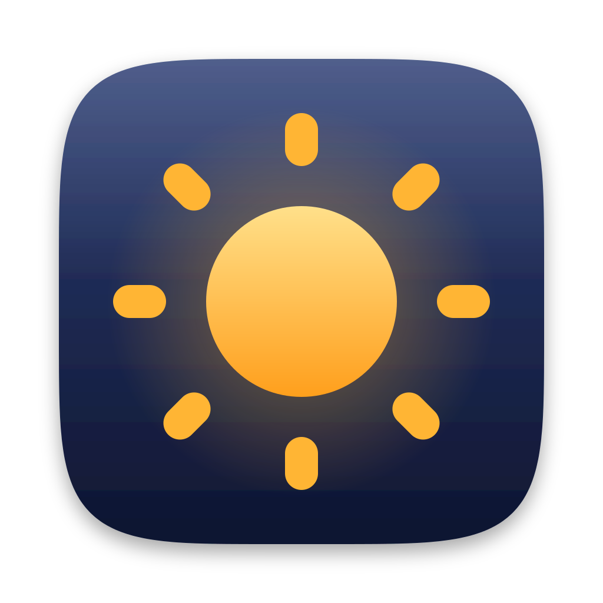

# Awake

<p align="center">
  
</p>

A native macOS menu-bar app by **Mario Codarin**. Daily stand-in for:

```sh
sudo pmset -a disablesleep 1   # disable sleep
sudo pmset -a disablesleep 0   # allow sleep again
```

One toggle. Password once, then never again. No Dock icon. Quitting restores normal sleep.

Requires macOS 13 or later on Apple Silicon.

## Download

Get the ready **macOS arm64** app from [Releases](https://github.com/MarioCodarin/Awake/releases/latest):

1. Download `Awake-1.0.3-macos-arm64.zip`
2. Unzip and drag `Awake.app` into `/Applications`
3. Open it. First launch: right-click the app → **Open** (ad-hoc signed, not notarized)

Intel Macs: build from source instead.

## Build from source

```sh
./scripts/build-app.sh
```

Drag `dist/Awake.app` into `/Applications` and open it. A moon appears in the menu bar.

**Disable sleep** is `pmset -a disablesleep 1` / `0`. The first toggle asks for your password once and installs a tiny root helper that can only run those two commands. After that, the switch needs no password. The menu-bar app itself never runs as root.

## Usage

Click the moon. Toggle **Disable sleep**.

- **On** — the Mac will not sleep, and the switch shows when it will turn itself off (for example "Until 3:42 PM").
- **Off** — sleep is allowed again.
- **Quit** (power button or ⌘Q) turns sleep back on before the app exits, so a closed Awake never leaves the Mac unable to sleep. Quitting never asks for a password.
- **Duration** — Indefinite, 15 minutes, 30 minutes, 1 hour, or 2 hours. The timer starts when you switch on (or change the duration); reopening the popover does not restart it.
- **Keep display on** — also stops the display from sleeping.
- **Launch at login** — reliable once the app lives in `/Applications`.

The menu-bar icon is a moon when sleep is allowed and a sun while sleep is disabled.

## How it works

Two layers work together while **Disable sleep** is on:

1. **System flag** — `pmset -a disablesleep 1`, applied through the sudoers-scoped helper at `/Library/PrivilegedHelperTools/com.mariocodarin.Awake.pmset`. This is what greys out  → Sleep. Awake reads `pmset -g` on launch and whenever the popover opens, so it always shows the real state (including a flag left on by an earlier session or by you in Terminal).
2. **IOKit assertions** held by the app process:
   - `PreventUserIdleSystemSleep` named `Awake`
   - `PreventSystemSleep` named `Awake` (stronger on AC; macOS may ignore it on battery)
   - `PreventUserIdleDisplaySleep` named `Awake Display` when **Keep display on** is checked

Check it:

```sh
pmset -g | grep SleepDisabled   # SleepDisabled 1 while on
pmset -g assertions             # lists the "Awake" assertions
```

Lid close can still sleep a portable in some configurations.

## Security model

- The helper runs only `/usr/bin/pmset -a disablesleep 0|1`. The sudoers rule (`/etc/sudoers.d/awake-pmset`) allows exactly `helper 0` and `helper 1` for your user.
- The installer script is embedded in the app and handed to `osascript` as an argument. Nothing in the app bundle or a temp file is executed as root.
- To remove everything: `sudo rm /etc/sudoers.d/awake-pmset /Library/PrivilegedHelperTools/com.mariocodarin.Awake.pmset`.

## Privacy

Awake never leaves this Mac. No network, no accounts, no analytics.

## Build and test

Requires Swift 5.9+ (Xcode Command Line Tools are sufficient).

```sh
swift run AwakeChecks
./scripts/build-app.sh
open dist/Awake.app
```

## Architecture

Five modules with one dependency rule. See [docs/ARCHITECTURE.md](docs/ARCHITECTURE.md).

## License

MIT. Copyright © 2026 [Mario Codarin](https://github.com/MarioCodarin).
